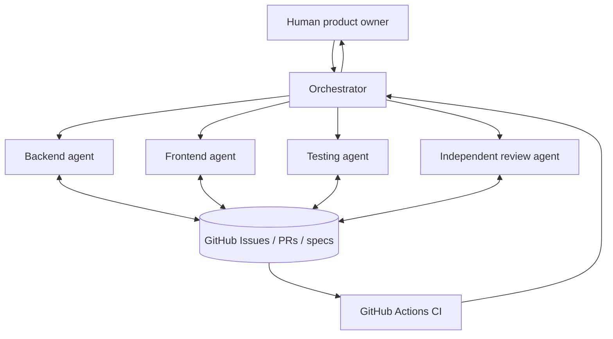

# OpenClub — AI-assisted development and agent coordination

> Working notes distilled from the project discussion on 13–14 November 2026. This is an edited record of the discussion and proposed approach, **not** a verbatim export of the ChatGPT conversation or a finalized architecture decision.

## Project direction

OpenClub is intended as an open-source, free-to-use platform for sports clubs, potentially expanding to nonprofit organizations generally. The original use case is a floorball club. Questions discussed include whether to support clubs beyond one sport from the beginning, how to keep costs low, using GitHub/Copilot, Kotlin versus TypeScript across frontend and backend, and whether alternative legal transfer/storage technologies are worth considering.

**Proposed approach:** Build one usable vertical slice for a club first, while keeping the domain model general enough for multiple clubs and sports. Avoid prematurely building a complex infrastructure or multi-agent platform.

## AI coding tools: comparison and budget

The conversation evaluated ChatGPT/Codex, Claude/Claude Code, and GitHub Copilot for coding, architecture, review, and multi-agent workflows.

| Tool | Proposed role |
| --- | --- |
| Claude Code | Primary hands-on coding agent; repository exploration, implementation, refactoring and subagent coordination |
| ChatGPT / Codex | Requirements and architecture discussions; independent implementation or code review |
| GitHub Copilot | IDE completions and day-to-day coding assistance |
| GitHub Actions | Automated tests, linting and integration gates |

The suggested **initial subscription configuration** was Claude Max 5x + ChatGPT Plus + GitHub Copilot Pro, with the aim of staying below a **US$200/month** combined budget and leaving headroom for API usage or upgrades. Pricing and usage limits change: verify them with the vendors before subscribing. Subscription access and API billing are not necessarily interchangeable.

An agent's apparent performance varies by repository, task, model and limits. Measure outcomes rather than assuming a universal winner. Upgrade only after tracking real usage, quality, latency, and review effort.

## Proposed multi-agent architecture

Use a **central orchestrator with decentralized task execution**. Agents should communicate through durable artifacts, not rely on sharing each other's private chat context.



### Communication channels

| Channel | Responsibility |
| --- | --- |
| GitHub Issues | Durable tasks, ownership, status, acceptance criteria and dependencies |
| Git branches and pull requests | Code exchange, review feedback, integration history |
| Versioned Markdown, YAML, OpenAPI | Shared contracts, architecture decisions and structured handoffs |
| Agent messages/events | Short questions, blockers, handoffs, review feedback |
| CI results | Machine-verifiable signals about tests, formatting and build status |

A Claude Code subagent and a Codex agent do **not** automatically share memory or an internal dialogue. Shared GitHub artifacts and explicit handoffs provide the bridge.

### Agent roles and permissions

- **Orchestrator:** Decomposes work, assigns owners, tracks dependencies, coordinates integration and escalates decisions.
- **Backend:** Implements APIs, data model, authorization, migrations and unit tests.
- **Frontend:** Implements user-facing flows using agreed API contracts.
- **Testing:** Implements and runs unit/integration/acceptance tests.
- **Reviewer:** Independently assesses correctness, security, architecture, maintainability and contracts. Prefer read-only access initially.
- **Human:** Approves key scope/architecture decisions, sensitive changes and merges.

Each coding agent should have a separate **Git worktree and branch**. Avoid multiple agents editing the same working directory.

Direct agent-to-agent clarification is allowed, but the result should be recorded in the relevant issue or contract. Only the orchestrator should own overall task coordination; human approval still governs integration.

## Example: membership management feature

1. Product owner requests club membership management.
2. Orchestrator defines task dependencies, acceptance criteria, API contract and data model.
3. Backend agent implements membership endpoints and migrations.
4. Frontend agent implements membership screens against the agreed contract, possibly in parallel.
5. Testing agent checks behavior and edge cases.
6. Review agent checks authorization, data isolation and implementation.
7. Orchestrator integrates reviewed changes, and CI runs.
8. Human reviews and approves the merge.

Parallelize work *after* contracts are sufficiently stable. For a multi-tenant platform, club isolation and permissions are essential acceptance criteria.

## Example repository conventions

```text
docs/
  architecture/
    ai-agent-development.md  # this document
    decisions/                # architecture decision records (ADRs)
  api/                        # OpenAPI contracts
.agents/
  protocol/
    task.schema.json
    message.schema.json
    handoff.schema.json
  tasks/
    TASK-001.yaml
```

This is a **proposed** structure, not an assertion that these directories already exist.

### Task example

```yaml
id: TASK-001
title: Implement membership API
assigned_to: backend-agent
status: in_progress
depends_on:
  - TASK-000
inputs:
  - docs/api/membership.yaml
expected_outputs:
  - membership endpoints
  - database migration
  - unit tests
acceptance_criteria:
  - Create, update, and list memberships
  - Enforce authorization and club isolation
handoff_to:
  - testing-agent
  - review-agent
```

### Message types

- `TASK_ASSIGNED`: assignment and scope
- `HANDOFF`: versioned outputs ready for a downstream agent
- `QUESTION`: clarification needed
- `BLOCKED`: dependency or capability blocking progress
- `REVIEW_FEEDBACK`: findings requiring action

Every message should identify its task ID, sender, recipient, links to artifacts, and actionable next step. Store critical decisions in version control or the relevant GitHub Issue rather than only in transient chats.

## Technology choices discussed (not finalized)

An initial suggestion was TypeScript frontend and backend, PostgreSQL, REST/OpenAPI, GitHub Actions, and Markdown/Mermaid documentation. **Kotlin for frontend and/or backend remains a legitimate alternative under evaluation**, not a rejected option. Decide stack choices using development experience, deployment costs, ecosystem maturity, and project complexity.

For agent integration:

- **MCP** exposes tools and context; it is not by itself a complete inter-agent messaging protocol.
- A lightweight orchestrator can coordinate vendor-specific agents using GitHub as the durable backbone.
- A2A-style agent communication, a database-backed task state machine, and a queue (e.g. Redis) may become useful with scale, but should not be required to ship the first feature.

## Practical rollout and safeguards

1. Establish repository conventions, `AGENTS.md`, CI, tests and code review expectations.
2. Implement a single end-to-end membership feature with a clear contract.
3. Add one additional coding agent and an independent reviewing agent.
4. Use separate branches/worktrees and structured task handoffs.
5. Measure costs, completion time, defects, token usage, merge conflicts and human review load.
6. Add queueing, agent registries or swarm coordination **only if observed bottlenecks justify them**.

Protect credentials, customer/member data, repository write permissions, and production deployment paths. Untrusted issue text, external content and agent outputs must not become unquestioned instructions. Apply least-privilege access and mandatory CI/human approval for consequential changes.

## Open questions

- Should the first release target one floorball club, all sports clubs, or nonprofits generally?
- TypeScript full-stack or Kotlin for some/all components?
- What is the minimal organization/club membership and role model?
- What deployment architecture can be low-cost and reliable?
- What exact task/handoff schema should be standard across Claude Code and Codex?
- Which integrations should be prioritized for the initial usable release?

## Context

This note is based on a ChatGPT project conversation about OpenClub, the relative strengths of ChatGPT Pro/Codex and Claude/Claude Code, a monthly AI coding budget up to $200, and how coding agents should communicate. Recommendations are provisional; implementation and vendor pricing need verification.
