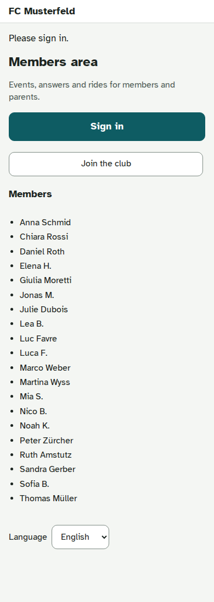
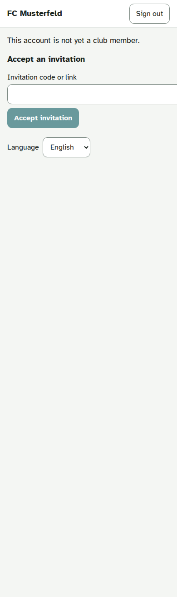

# OpenClub guides

One guide for each kind of person who uses a club's OpenClub, and a separate one for the person who runs the server.
Button and field names are the English ones; the app also speaks German, French and Italian (*Family* → *My profile* → *Language of the app*).

> **Fictional data only.** OpenClub is in a synthetic-data test phase. Do not enter real people's names, birth dates,
> addresses or phone numbers until the club's privacy approval is complete (see the [README](../../README.md)).

| You are … | Read |
| --- | --- |
| A member, or a parent of a young player | [Members and parents](members-and-parents.md) |
| A coach or team manager (`VIEW_TEAMS` / `MANAGE_TEAMS`) | [Coaches and team managers](coaches.md) |
| The treasurer (`MANAGE_FEES`) | [Treasurer](treasurer.md) |
| A club administrator (members, permissions, settings) | [Administrators](administrators.md) |
| The person who installs and runs the server | [Operator guide](../operations/operator-guide.md) (not for club members) |

Most people hold more than one role: a coach is usually also a parent. Each guide describes only its own tasks.

The pictures in these guides show the fictional demo club *FC Musterfeld* in English. They are taken automatically
from the running app after every change that passes the browser tests, so they match the current version; see
[documentation maintenance](../contributing/documentation.md#screenshots-in-the-guides). **[Every screen](screens.md)** shows all pages in one place.

## Finding your way (everyone)

The app shows one page at a time. At the top are the club's name (back to *Start*) and *Sign out*. The language is chosen once under *Family* →
*My profile* (*Language of the app*, for this device); before signing in, at the bottom of the start page.
The main menu sits at the bottom of a phone screen and on the left of a computer screen. Entries you cannot use are
not shown at all, and the server checks every action again.

| Page | What it is for | Who sees it |
| --- | --- | --- |
| *Start* | *Things for you to do* (events that still need your answer or your child's, with *Yes*, *No*, *Maybe*), a free seat to book, the next 7 days, announcements | Everyone |
| *Schedule* | The next eight weeks by day, *Called up* for matches, and *When fields and halls are booked* | Everyone |
| *Family* | *My profile*, *My children*, *Absences*, *Fees* (with helper shifts), *Calendar subscription*, *Email notifications* (with push) | Everyone; *My children* only for guardians |
| *Team* | *Next events*, *Helpers missing*, the teams and each team's *Schedule*, *Members* and *Statistics* | Coaches and team managers |
| *Administration* | *Waiting for you*, *Members*, *Join requests*, *Fees*, *Fields and halls*, *Permissions*, *Settings* | Only the sections a person has a permission for |

Every page has its own address, so the browser's back button and bookmarks work. On a phone, wide lists show one card
per row instead of a table.

**On the home screen:** in the phone's browser choose *Add to Home Screen* (Safari: share button; Chrome: menu). The
club page then opens like an app with its own icon. On an iPhone this is also needed for push notifications.

## Signing in (everyone)

Choose *Sign in*. You are sent to the club's sign-in service, then back to the club page. If it says *This account is
not yet a club member*, your account works but no member record is linked to it: ask the club for an invitation, or
paste one you received into *Accept an invitation*. *Sign out* ends your session on this device.

 

## Privacy in short

- Contacts (email, phone, birth date) are shown only to people the club explicitly allowed. The one exception is
  carpooling: a driver and the people they carry see each other's phone.
- Children appear to other members as first name and surname initial.
- An absence never shows a reason; coaches see only *No*.
- Every read of private details and every change to member data is recorded (identifiers only).
- Questions about your data go to the club; the operator handles permanent deletion.
