# Guide for club administrators

For members who run the club in the app. Each part needs its own permission; the *Administrator* role alone allows
nothing except protecting the last administrator. Everything is under *Administration*, which opens on *Waiting for
you*: open join requests, helper shifts of the next 14 days that still need people and fee periods with unpaid fees,
each with a button to the right section. The treasurer's tasks are in the [treasurer guide](treasurer.md), the
coaches' in the [coach guide](coaches.md).

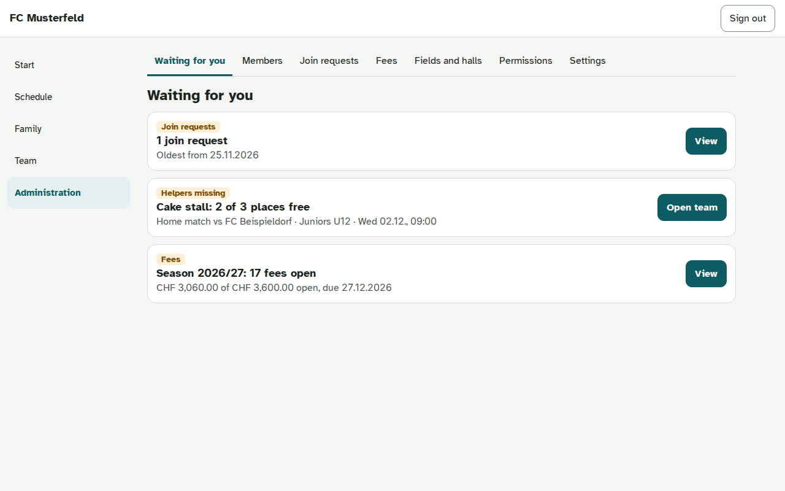

## Members (`EDIT_MEMBERS`)

*Administration* → *Members* shows the member list and form; the other member tasks have their own pages (*More
tasks*): *Invitations and accounts*, *Guardians*, *Club roles* (with `MANAGE_PERMISSIONS`), *Excel import and export*,
*Archive* and *Public member list*.

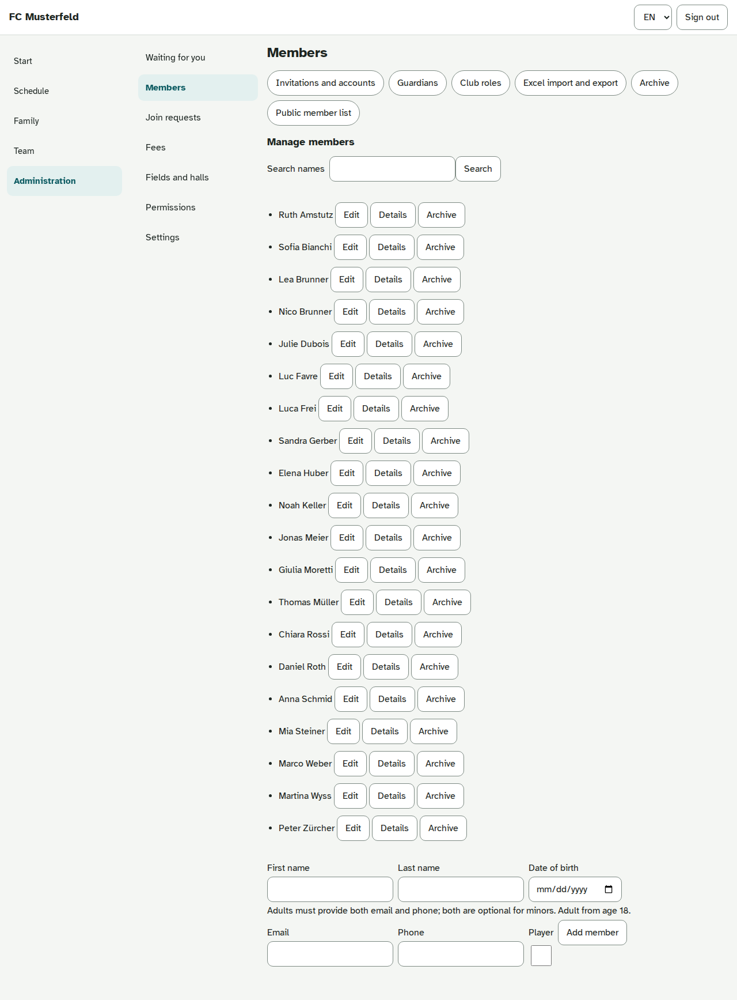

- **Find, add, edit:** *Search names*; tap a name to open the member. *New member*, then *Add member* with first and last name, date of birth and, for adults, email and
  phone; *Player* (with *Gender* if the club requires it). *Edit* starts from the current values and refuses to save
  if someone else changed the member meanwhile. In the form: *Show on public member list* (untick on objection) and
  *J+S person number* (digits only, used only for the coaches' J+S file).
- **An opened member** shows the stored fields, the sign-in and invitation state, then *Edit* and *Archive*; **Export all data (JSON)** answers a person's
  request for their data (recorded; give it only to the verified person).
- **Archive** (then *Confirm archive*; *Undo archive* right after) removes the member from lists, permissions, teams and
  guardianships. Only *Member*-role members without a linked sign-in can be archived. The *Archive* page lists archived
  members; *Reactivate* brings one back without former rights. Archived members are erased automatically after
  24 months; earlier erasure on request is done by the operator.

  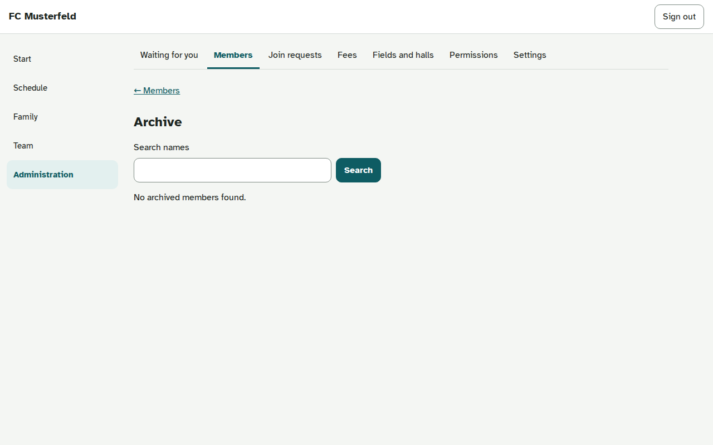

- **Public member list** (page): exactly what visitors see on the signed-out page: adults by full name, children by
  first name and initial, without members who chose not to be listed.

  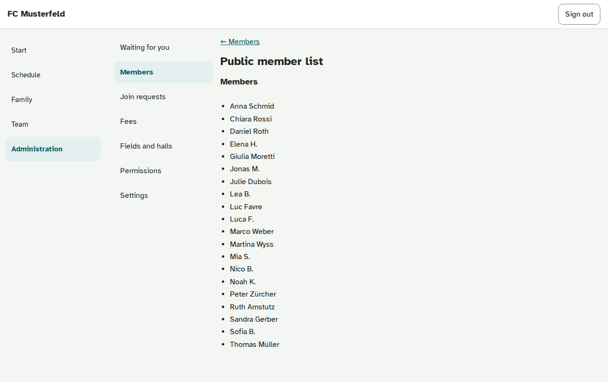

- **Excel:** download the member list as CSV, or import from *CSV UTF-8* (First name, Last name, Date of birth, and
  optionally Email, Phone, Gender, Player). *Check file* previews every row; nothing is created until *Import N
  members*; existing members are never changed.

  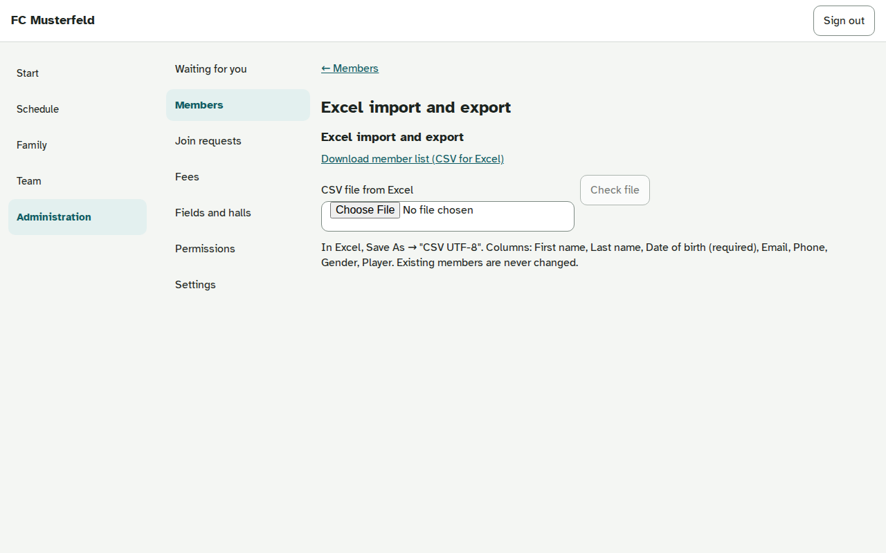

## Invitations and sign-in

1. *Invitations and accounts*: find the member, *Create invitation*, copy the link (shown once, valid seven days, works
   once) and send it through a channel you trust.
2. *Revoke invitation* cancels it. *Unlink account* disconnects a sign-in and ends the session at once; it needs
   `MANAGE_PERMISSIONS` and the *Administrator* role.

Minors and archived members cannot be invited.

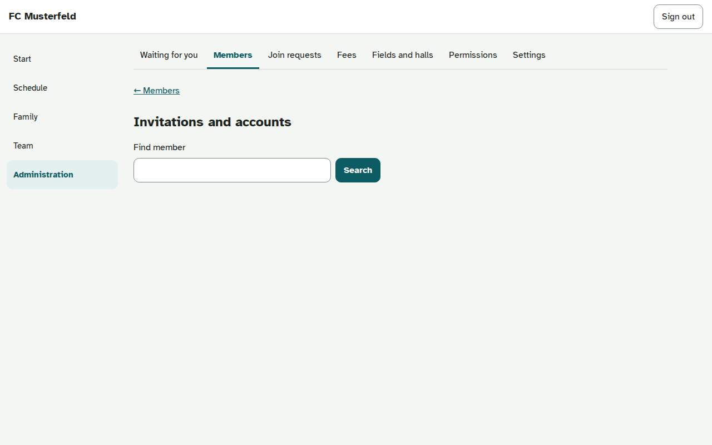

## Guardians

*Guardians*: find the minor, then *Find a guardian* (an adult member with a sign-in) and *Add as guardian*. You confirm
that you checked the relationship outside OpenClub. At most two per child. Guardianships end by themselves at the club's
adult age, on archiving or when the guardian's sign-in is unlinked. A guardianship gives no other permission.

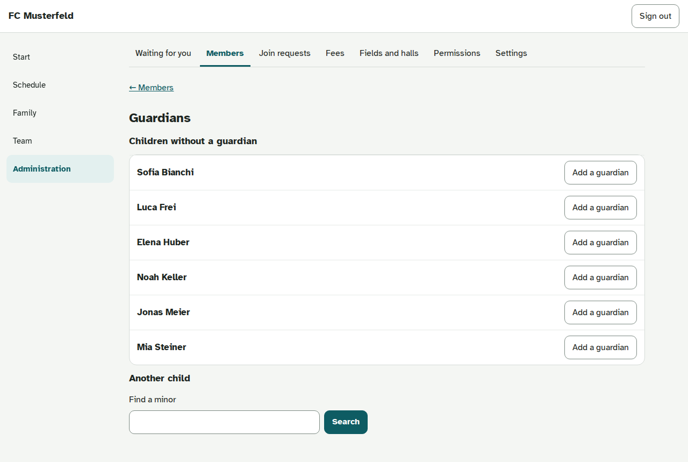

## Join requests (`EDIT_MEMBERS`)

*Join requests*: tick *Public application form is on* to show *Join the club* on the signed-out page. *Accept* creates the
member (and puts them in the wished team); *Decline* deletes the application. Unhandled applications are deleted after
60 days. For a child, link the parent as guardian afterwards.

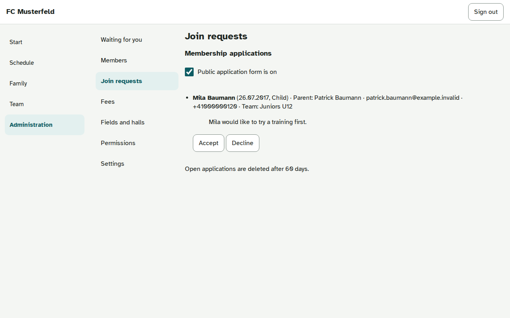

## Teams (`MANAGE_TEAMS` club-wide)

On the *Team* page, *New team*, a name and *Add team* create a team; each team's page has *Manage team* (*Rename*, *Delete team*) and
*Members* (*Assign*, *Remove*). Deleting a team deletes its schedule.

## Fields and halls (`MANAGE_VENUES`)

*Administration* → *Fields and halls*: *Add* the club's fields and halls by name, *Rename* or *Delete* them. Deleting
one keeps its events, without the place. Coaches then pick a field or hall per event and double bookings are refused.

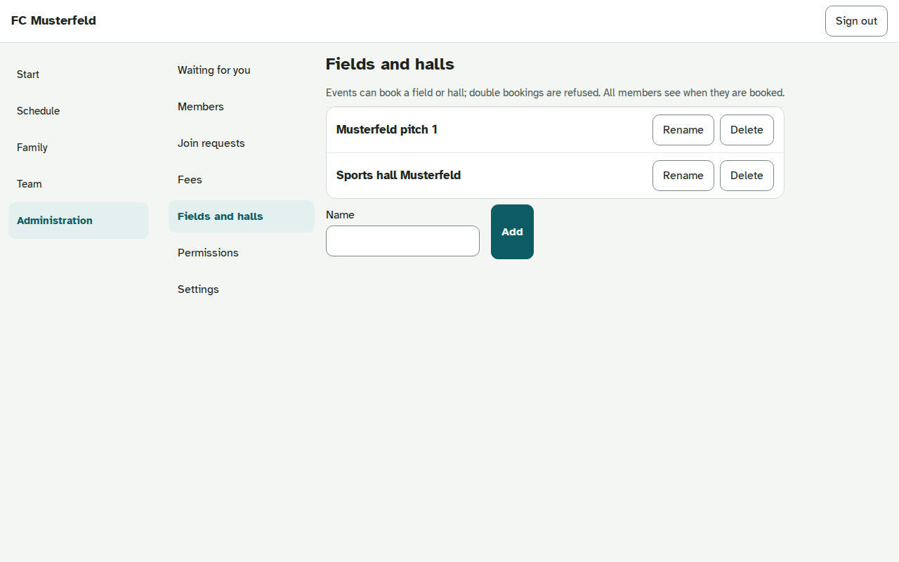

## Permissions (`MANAGE_PERMISSIONS`)

*Who can do what* lists everyone who holds a permission, with each permission in plain words (a team permission
names its team). *Change* next to a name opens that member below. To give a permission to someone not yet listed, find
the member, choose the *Scope* (*Club* or one *Team*) and the *Capability*, then *Grant*; *Revoke* removes one. A
change applies to the member's next action.

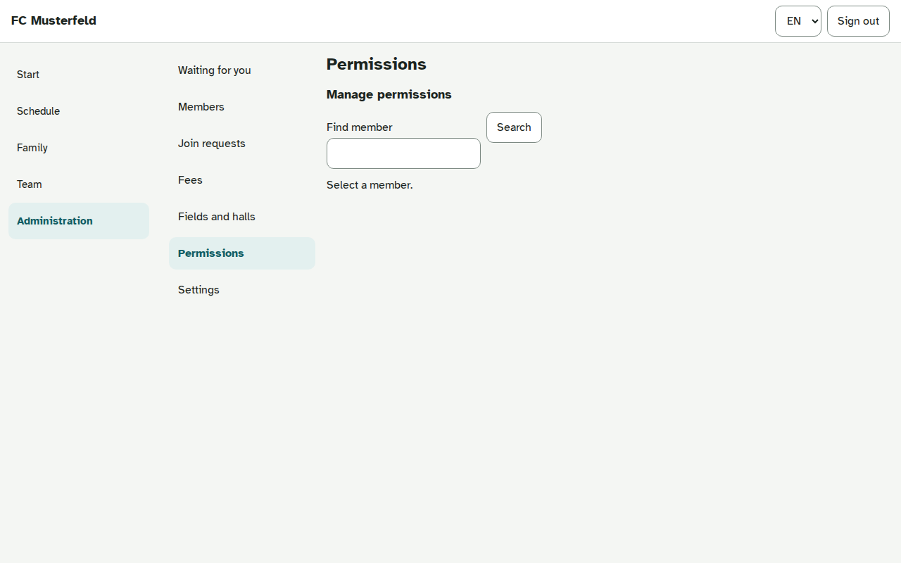

| Capability | Shown as | Allows |
| --- | --- | --- |
| `VIEW_MEMBER_DIRECTORY` | *See the member list* | Searching members by name |
| `EDIT_MEMBERS` | *Edit members* | Members, archive, guardians, invitations, import and export, join requests, J+S numbers |
| `VIEW_TEAMS` | *See teams* | Seeing teams, their members, schedules and statistics (club-wide or one team) |
| `MANAGE_TEAMS` | *Run teams* | Managing teams, schedules, shifts, squads, attendance, J+S files, coach messages and team announcements, and reading active team members' contacts (club-wide or one team) |
| `MANAGE_PERMISSIONS` | *Manage permissions* | Granting and revoking permissions, club roles and settings; with the *Administrator* role also unlinking sign-ins |
| `MANAGE_FEES` | *Manage fees* | Fees, QR-bill payment details and helper duty (club-wide only) |
| `POST_ANNOUNCEMENTS` | *Post announcements* | Announcements to the whole club (club-wide only) |
| `MANAGE_VENUES` | *Manage fields and halls* | The club's fields and halls (club-wide only) |

The first administrator holds every club-wide capability from the start. *Club roles* switches a member between
*Member* and *Administrator*; the last administrator cannot be demoted.

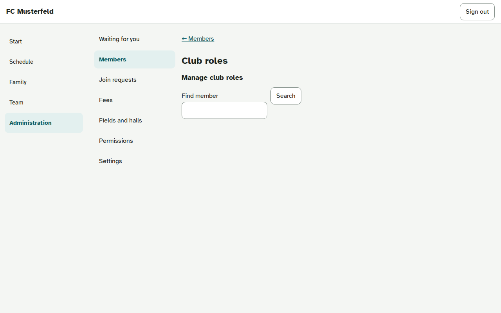

## Announcements (`POST_ANNOUNCEMENTS`)

On *Start*, choose *For* (the whole club or a team you manage), *Title*, *Text*, optionally *Show until* (default 60
days), then *Post*. Announcements are deleted 6 months after their show-until date.

## Club settings (`MANAGE_PERMISSIONS`)

*Edit club name*; *Adult age* (13 to 25, default 18; raising it is refused while members who would become adults lack
email or phone); *Require gender for players*.

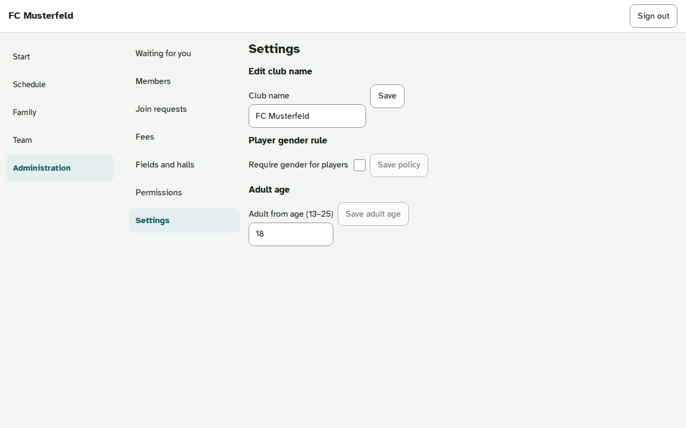

## What the operator does instead

Server problems, permanent deletion on request, recovery of a lost sole administrator and backups are for the
operator ([operator guide](../operations/operator-guide.md)).
