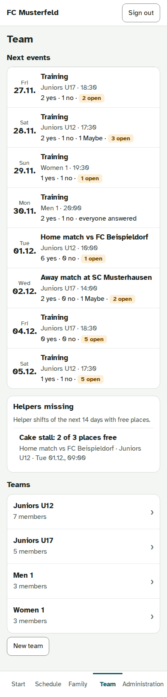
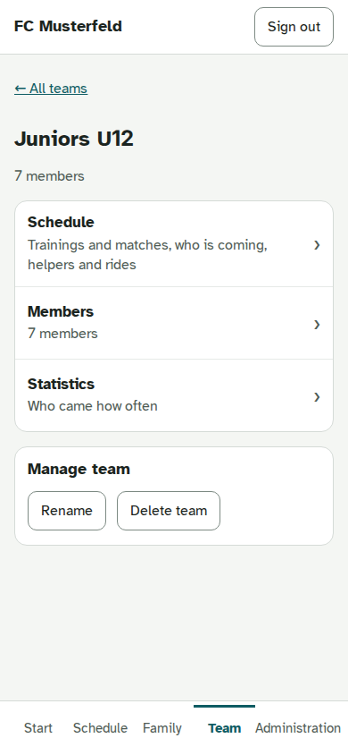
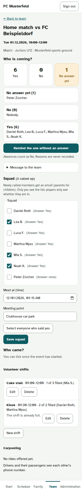
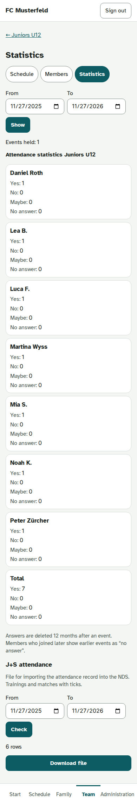
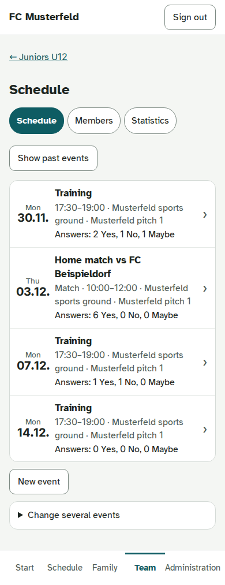
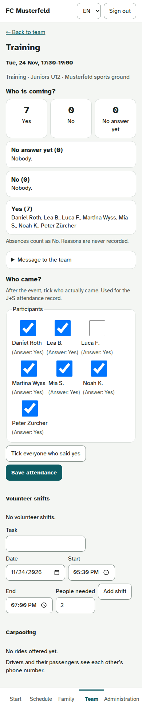
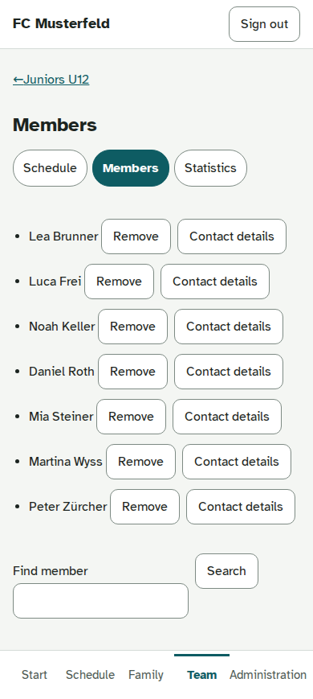

# Guide for coaches and team managers

For members with `VIEW_TEAMS` (see a team) or `MANAGE_TEAMS` (manage a team), club-wide or for one team. Everything
here is on the *Team* page and on each event's coach page. See the [overview](README.md) for finding your way.

## Who is coming

- **Next events** opens the *Team* page: the next 14 days of your teams (at most eight teams) with totals and how
  many have not answered (*11 yes · 2 no · 3 open*).

  

- **A team's page** (tap the team) leads to its *Schedule*, *Members* and *Statistics*; with `MANAGE_TEAMS` also
  *Manage team*.

  

- **An event's page** starts with *Who is coming?*: totals, then the names under *No answer yet*, *No*, *Maybe* and
  *Yes* (adults by full name, children by first name and initial); a group nobody is in is left out. Absences count as
  *No*. A note a member or parent added to an answer or an absence (*Comes at 18:30*, *School camp*) stands under the
  group as *Name: note*; only coaches and team viewers see it. Below come *Squad* (matches) and *Message to the team*, each opened by tapping its
  title, then helpers and rides, and last *Change, cancel or delete the event*.

  

- **Remind** (`MANAGE_TEAMS`): *Remind all 3 without an answer* emails them (parents for their children), at most every
  12 hours. An automatic reminder also goes out two days before every event.
- **Attendance statistics:** the team's *Statistics* page shows, for up to a year (*From*, *To*, *Show*), the events
  held and the totals, then one row per member with their answers and a bar for the share of *Yes*. Answers are
  deleted 12 months after an event.

  

## Planning the schedule (`MANAGE_TEAMS`)

- A team's *Schedule* shows eight weeks. *New event*, then *Kind* (Training, Match, Event), *Title*, *Date*, *Start*, *End*,
  optionally *Place*, *Field or hall* (if the club keeps a list) and *Notes*. *Repeat weekly until* creates up to 52
  copies keeping the local time; *Add event* saves.
- On the event's own page (tap it in the schedule), at the bottom under *Change, cancel or delete the event*: *Edit*,
  *Cancel event* (members still see it, marked *Cancelled*; *Reinstate* undoes it) and *Delete*.
- **No double booking:** as soon as date, start and end are filled in, *Field or hall* marks each one that is already
  booked then, with the team and time (for example *Hall North (booked: U14 18:00–19:30)*), and it cannot be chosen.
  For a weekly series only the first date is checked; a later clash is refused on saving with the other event's
  team, title and time. Before you plan, look at the week plan under *Schedule* → *When fields and halls are booked*: every day of a
  week with what is booked where, so you see which field or hall is free.
- **Change several events:** at the bottom of the schedule choose *From*, *To*, the kinds and *Cancel*, *Reinstate*,
  *New place* or *Another field or hall*, then *Check*; it says how many events change, and *Change N events* applies
  it. Only events that have not started change, and each person gets one email listing them.

## Helpers, rides and messages

- **Volunteer shifts:** *New shift* adds a helper job to an event (*Task*, times, *People needed*, *Add shift*); the team sees who signed up.
  *Helpers missing* on the *Team* page lists shifts of the next 14 days with free places. Seven days before such a
  shift the team and the parents are asked by email.
- **Rides:** the event page lists the team's carpool offers and bookings.
- **Message to the team:** on an event's page choose *Everyone in the team*, *Everyone who said yes*, *Everyone
  without an answer* or (for a match) *The squad*, write a *Subject* and *Message*, then *Send*. The server emails
  them (parents for their children) with your name; nobody sees any address. At most 10 messages per team and day.

## Matches: the squad (Aufgebot)

For a match, tap *Squad* on the event page (its title shows how many are called up) to see the team with their
answers. Tick who is called up (*Select everyone who said yes* helps), optionally the time to *Meet at* (on the match
day; a time after kick-off means the evening before) and the *Meeting point*, then *Save squad*, until the match starts. Members called
for the first time get an email (parents for children); removing someone sends nothing. Only you see the list; each
player and parent sees only their own status.

## After the event: who came, and J+S

- **Who came?** appears on the event page once it has started. After the event, open it from the team's *Schedule*
  with *Show past events* (the last eight weeks); then tick the leaders (members with a manager grant for the
  team) and participants who were there and *Save attendance*. You can correct it later. The ticks stay with the event,
  also after a member leaves the team.

  

- **J+S attendance** on the team's *Statistics* page uses the same period as the statistics above. It shows how many rows the file
  will have, who has no J+S person number (an administrator adds it) and which trainings have no place. *Download file*
  gives the CSV for the import of the attendance record (*Anwesenheitskontrolle*) in the NDS. Trainings become
  *Training* with time, duration and place, matches *Wettkampf*. Every download is recorded. The import itself is done
  in the NDS by the club's J+S coach.

## The team's members

The team's *Members* page lists one row per member; tapping a name shows an **active** team member's email and phone.
With `MANAGE_TEAMS`, *Remove from team* sits inside that row, and *Add a member* below the list finds and assigns one. Birth dates stay hidden; each contact read is recorded.

## Team announcements

With `MANAGE_TEAMS` you post announcements for your team on *Start* (*For*, *Title*, *Text*, *Show until*). Do not
put private details such as health or addresses into them.
