# Guide for members and parents

What a member sees without any extra permission, and what a parent (guardian) of a young player can do for their
child. See the [overview](README.md) for finding your way and signing in.

## Answering events

- **Start** shows *Things for you to do*: each event that still needs an answer from you or your child, soonest first,
  with *Yes*, *No* and *Maybe* in the card. One tap answers; the card then leaves the list. The next three are shown;
  *Show all* lists the rest. Below them, *Also in the next 7 days* and the announcements.

  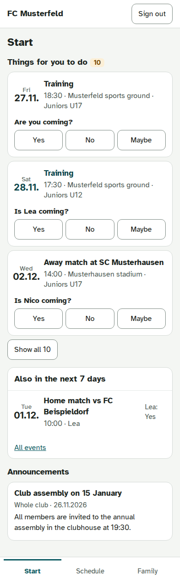

- **Schedule** lists the next eight weeks of your teams (and your children's teams), each card with its date. With
  children, the buttons at the top show *Everyone*, *Me* or one child. An event still waiting for you shows *Yes*, *No*
  and *Maybe*; once answered it shrinks to one line ("Is Lea coming? ✓ Yes") with *Change*. Tap a card for its page.
  You can answer until the event starts; choosing your answer again clears it. You see the team's totals, never other
  members' answers.

  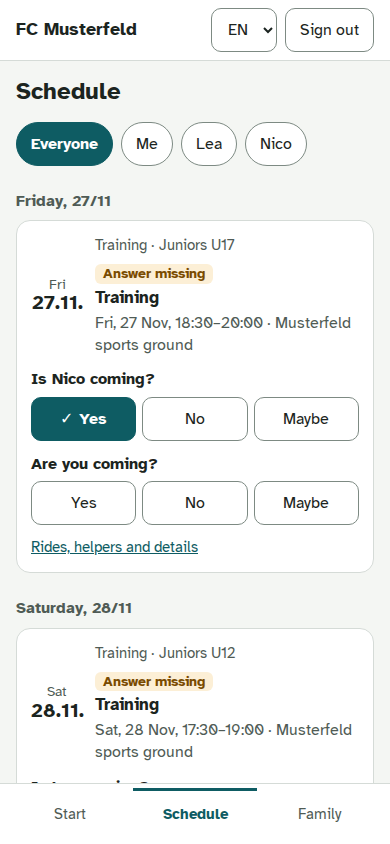

- **One event:** tap it to see when and where, notes, your answers, the totals, helper shifts and rides.

  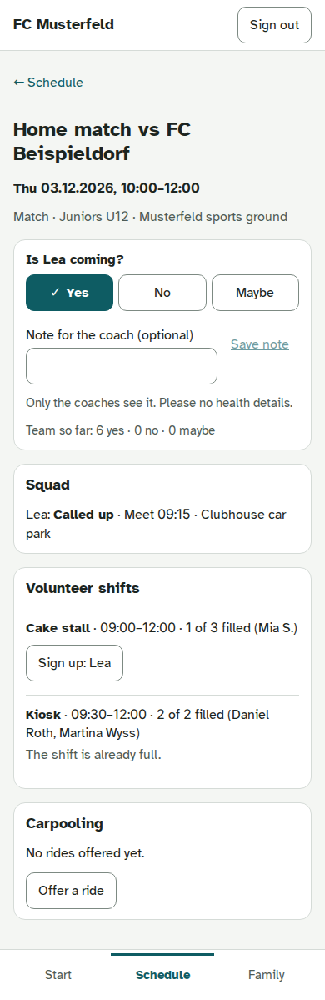

- **Fields and halls:** *When fields and halls are booked*, at the bottom of *Schedule*, shows the bookings of each of
  the club's fields and halls.

  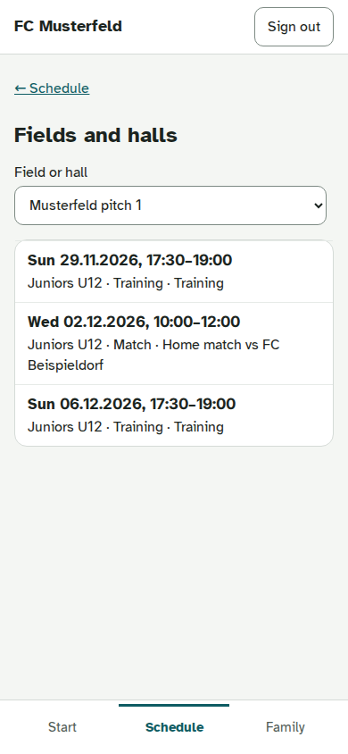

- **Called up:** for a match the coach may call up a squad. If you or your child are in it, the schedule shows
  *Called up* and the event page shows the meeting time and place; otherwise *Not called up*. You never see who else
  is called up.

## Helping, rides and absences

- **Helper shifts:** on an event's page, *Sign up* puts you (or your child) on a shift while places are free;
  *Withdraw* takes you off, both until the shift starts. The team sees your name on the shift.
- **Helper duty:** if the club asks each family for a number of shifts per season, *Family* → *Fees* shows, for
  example, *1 of 3 helper shifts this season*. Shifts count once they have taken place, your children's too.
- **Carpooling:** an event's page lists rides with driver, direction, departure, meeting point and seats. *Offer a
  ride*, *Book seat* for you or your child, *Withdraw ride*. Once booked, you and the driver see each other's phone;
  nobody else does. *Start* suggests a free seat for events you said *Yes* to.
- **Absences** (*Family* → *Absences*): enter the days you or your child are away. Every unanswered event on those days
  counts as *No*; you can still answer *Yes*. No reason is asked or stored.

  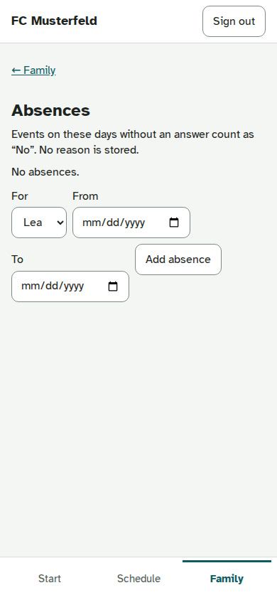

## Staying informed

- **Announcements** on *Start*: club-wide news and news for your teams, newest first.
- **Email notifications** (*Family* → *Email notifications*): one switch each for event changes, new events,
  announcements, the shift reminder the day before, *Helpers wanted*, *Answer missing*, *Called up for a match* and
  *Messages from the coach*, plus the language of the emails. Changes save at once. You need an email address. If the
  club sends neither emails nor push, the page says so and shows no switches.
- **Push notifications** (same page, below the switches): if the club offers them, *Turn on for this device* shows the
  same messages on that phone or computer. On an iPhone add the app to the home screen first. *Turn off for this
  device* stops them. The push itself carries no text; your device fetches it from the club's server.
  Signing out also turns them off on that device, so on a shared computer the next person gets none of yours.

  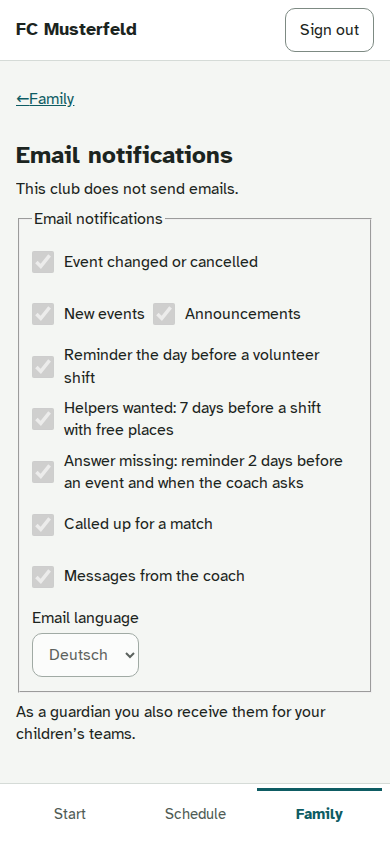

- **Calendar subscription** (*Family* → *Calendar subscription*): *Create link* gives a private link for your phone's
  calendar with your and your children's events. Anyone with the link sees your schedule; *Create a new link* or
  *Revoke link* ends the old one.

  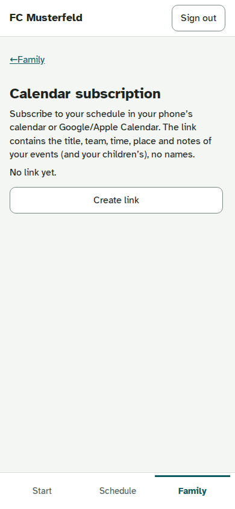

## Fees

*Family* → *Fees* shows one card per fee (yours and your children's): for whom, *Open* or *Paid*, the amount and the
due date. On an open fee, *Pay with QR bill (PDF)* downloads a Swiss QR bill to pay in your banking app; until the
treasurer has entered the club's account, the card says the bill will follow. A fee shows as paid only after the treasurer has seen the payment.

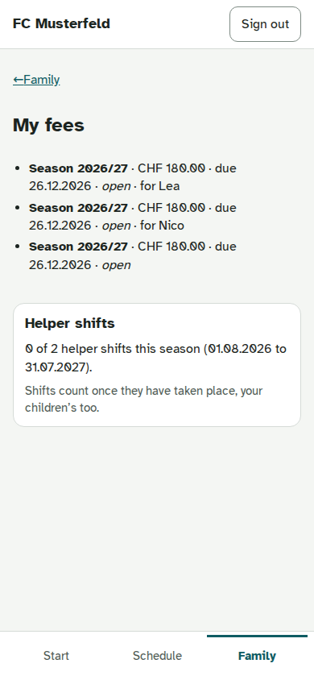

## Your own record

*My profile* shows what the club stores about you: name, date of birth, gender (if recorded), whether you play, your
role, teams and your J+S person number (if the club entered one). Change your *Email* and *Phone* there; other details
are changed by the club. Untick *Show my name on the public member list* to take your name off the list anyone can see. *Language of the app*
sets the language on this device; the language of emails is set under *Email notifications*.

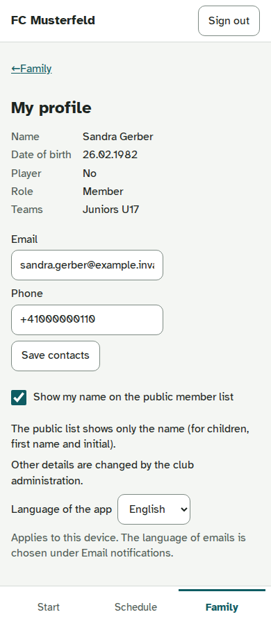

## For parents (guardians)

If the club recorded you as a guardian, *Family* → *My children* lists your children by first name.

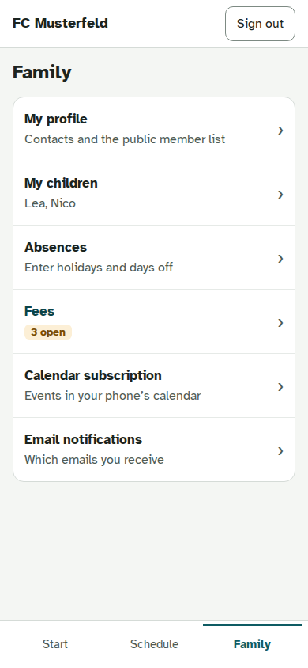 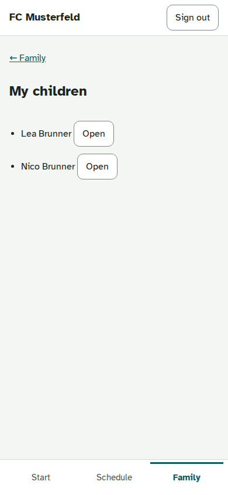

- Tapping a child's name shows their date of birth, whether they play and their teams; you can change the child's *Email* and
  *Phone*. Nothing else about the child, and nothing about other members, can be seen or changed.
- Your children's events appear on *Start* and *Schedule* (*Is Lea coming?*), and you answer for them there. You also
  sign them up for shifts, book them a seat, enter their absences and get the club's emails for their teams.
- Fees, QR bills and helper shifts include your children's.
- When a child reaches the club's adult age, or the club removes you as guardian, the child disappears from your
  pages.

## Joining the club

The signed-out start page shows *Sign in*, the club's public member list behind *Show members*, and the language
choice. If the club switched it on, it also shows *Join the club*: adults apply for themselves, parents for
a child. The club's administration then accepts or declines; an application nobody handles is deleted after 60 days.

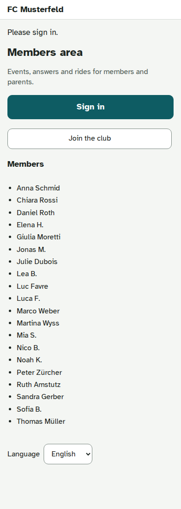

## Getting help

Problems with signing in, or a record you cannot change: ask a club administrator.
