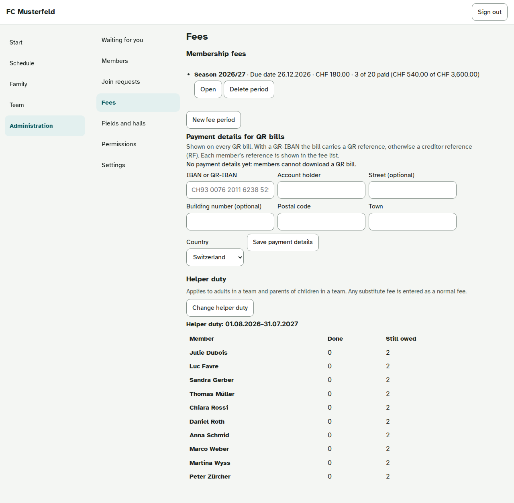

# Guide for the treasurer

For members with `MANAGE_FEES`. Everything is under *Administration* → *Fees*. OpenClub tracks who paid; it does not
collect money or read the bank account. See the [overview](README.md) for finding your way.

## Fee periods

- **New fee period:** *Name* (for example "Season 2026/27"), *Due date*, *Amount (CHF)*, then *Create period*. Every active
  member gets a fee at that amount.
- Each period is a card: what is still open first ("17 open · CHF 3,060.00 outstanding"), a bar and the paid count.
- **Open** a period to see each member's fee; *Show* filters *All*, *Open*, *Paid* or *Excluded*. Per member: *Mark paid*
  or *Mark unpaid*, *Change amount* (for example a reduced fee), *Exclude* (for example an honorary member) and
  *Include*. Archived members keep their fee.
- *Delete period* (type its name to confirm) removes it with all fees. Periods are deleted 24 months after the due date;
  keep what your bookkeeping needs outside OpenClub.
- *Waiting for you* on the *Administration* start lists periods with unpaid fees.

## Swiss QR bills

Below the periods, the card *Payment details for QR bills* shows the saved account and address. The first time, enter the club's *IBAN or QR-IBAN* (Switzerland or Liechtenstein), the *Account holder* and the
address, then *Save payment details* (each change is recorded); later, *Change payment details* opens the form again. From then on members and parents download a QR bill for
each open fee. With a QR-IBAN the bill carries a 27-digit QR reference, otherwise an *RF* creditor reference. The
*Reference* column of an opened period shows each member's reference, so you can match a payment in the bank statement
and then *Mark paid*.

## Helper duty

In the *Helper duty* card, *Change helper duty* sets *Shifts per season* (0 turns it off) and the month the season starts, then *Save*. The table
lists every adult in a team and every parent of a child in a team with *Done* and *Still owed*, fewest first. A shift
counts once it has taken place (not for cancelled events), for the helper and for the parents of a helping child. If
the club charges a substitute fee, create it as a normal fee period or change the member's amount.

## Good practice

- Each change to a fee is recorded with who did it and when.
- Fees are part of a member's data export.
- Do not write private reasons (illness, hardship) anywhere in OpenClub; agree them outside the app.
